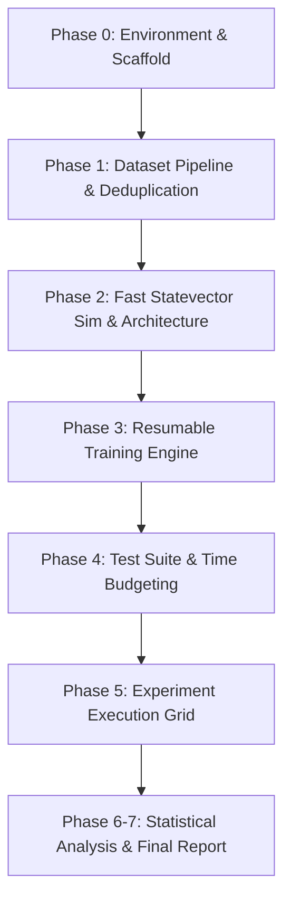

# Project Implementation Plan & Task List: QForge Hybrid Quantum-Classical Brain MRI Classifier

## 🎯 Project Goal
Reproduce and extend the paper *"Hybrid quantum-classical-quantum convolutional neural networks"* (Long et al., 2025). 
- **Core Contribution**: Upgrade the quantum convolutional filter from **frozen random parameters** (paper baseline) to **trainable end-to-end parameters** using PyTorch autograd.
- **Target**: Rigorously measure performance gains (Accuracy, Precision, Recall, F1, ROC-AUC) and parameter drift $||\theta - \theta_{\text{init}}||$ on CPU hardware.

---

## 🛠️ Execution Strategy & Phases

---

### **Phase 0: Hardware Detection, Scaffold & Environment Setup**
- [x] **Task 0.1**: Detect system specs (OS, CPU cores, RAM, disk space, Python versions, CUDA availability) and save to `results/hardware_info.txt`.
- [x] **Task 0.2**: Create directory `qforge-qmri/` and initialize git repository (`git init`).
- [x] **Task 0.3**: Create Python 3.12 virtual environment (`.venv`) using `py -3.12 -m venv .venv`.
- [x] **Task 0.4**: Upgrade core build tools (`pip`, `setuptools`, `wheel`) and install CPU-only PyTorch + `requirements.txt` dependencies.
- [x] **Task 0.5**: Execute installation verification script: test PennyLane + PyTorch autograd 4-qubit circuit & check core counts.
- [x] **Task 0.6**: Freeze lockfile `requirements-lock.txt` and generate `.gitignore`.
- [x] **Task 0.7**: Build exact workspace directory tree (`configs/`, `data/`, `src/qforge/`, `scripts/`, `tests/`, `results/`).
- [x] **Task 0.8**: Commit git snapshot (`"phase 0: environment and scaffold"`).
- **🛑 Checkpoint 0**: Completed & verified. Ready for Phase 1.

---

### **Phase 1: Data Pipeline, Deduplication & Preprocessing**
- [x] **Task 1.1**: Read C:\books\Quantum\qforge-qmri\archive (5,400 tumor images across 3 valid classes).
- [x] **Task 1.2**: Implement label mapping in `configs/base.yaml`:
  - **Malignant (1)**: Glioma
  - **Benign (0)**: Meningioma + Pituitary
  - **Excluded**: `notumor`
- [x] **Task 1.3**: Build `src/qforge/data.py` to preprocess images (grayscale, $28 \times 28$, normalized to $[0, 1]$) and cache `.npy` tensors in `data/cache/`.
- [x] **Task 1.4**: Generate stratified 80/20 train/val splits with fixed seed `42` and save CSV manifests in `data/splits/`.
- [x] **Task 1.5**: Execute hash-based deduplication (MD5 + perceptual hashing) to check for train/val/test data leakage.
- [x] **Task 1.6**: Implement class-weighted loss handling for minor class balance.
- [x] **Task 1.7**: Output data summary report & commit (`"phase 1: dataset pipeline and split manifests"`).
- **🛑 Checkpoint 1**: Completed & verified. Ready for Phase 2.

---

### **Phase 2: Fast Statevector Simulator & Hybrid Model Architecture**
- [x] **Task 2.1**: Implement vectorized PyTorch Statevector Simulator in `src/qforge/qsim.py` for 4-qubit quantum filters batched across images and $14 \times 14 = 196$ patches.
- [x] **Task 2.2**: Build PennyLane reference filter in `src/qforge/quantum_filter.py`.
- [x] **Task 2.3**: Write `pytest` test verifying exact output (atol $< 10^{-5}$) and autograd gradient parity between PyTorch simulator and PennyLane.
- [x] **Task 2.4**: Implement 4 Quantum Filter Modes:
  1. `frozen_random` (Registered buffer, disk output caching after pass 1)
  2. `trainable` (Identical seed init, separate optimizer group with higher lr)
  3. `classical_conv` (`Conv2d(1, 4, 2, stride=2)` + tanh control baseline)
  4. `none` (Direct CNN input without filter)
- [x] **Task 2.5**: Construct Classical Backbone (`Conv(4->16) -> Conv(16->32) -> Dense(64) -> Dense(2)` $\to (h_0, h_1)$ scaling to $[-\pi, \pi]$).
- [x] **Task 2.6**: Build 2-qubit VQC Classifier head (ZZ feature map + RealAmplitudes ansatz with 6 trainable parameters, outputting $\langle Z_0 \rangle \to \text{scale} \cdot \langle Z_0 \rangle + \text{bias}$).
- [x] **Task 2.7**: Commit snapshot (`"phase 2: fast statevector simulator, quantum filters, and hybrid architecture"`).

---

### **Phase 3: Resumable Training Engine & CPU Optimization**
- [x] **Task 3.1**: Build training loop in `src/qforge/train.py` with Adam optimizer (separate parameter groups for backbone and quantum filter).
- [x] **Task 3.2**: Configure CPU performance (`torch.set_num_threads`, single worker, memory caching).
- [x] **Task 3.3**: Add full epoch checkpointing (`model`, `optimizer`, `epoch`, `best_metrics`, `rng_state`) supporting seamless resumption.
- [x] **Task 3.4**: Integrate metrics tracking: loss, accuracy, epoch duration, gradient norms, parameter drift $||\theta - \theta_{\text{init}}||$.
- [x] **Task 3.5**: Commit snapshot (`"phase 3: training engine, resume capability, and logging"`).

---

### **Phase 4: Unit Testing & Hardware Budget Verification**
- [x] **Task 4.1**: Expand `pytest` suite in `tests/`:
  - Simulator vs PennyLane validation.
  - Filter output shapes $(B, 4, 14, 14)$ and value bounds $[-1, 1]$.
  - Non-zero autograd gradients in trainable mode vs zero gradients in frozen mode.
  - Seed identity check between frozen and trainable weight initialization.
  - Dataset split disjointness verification.
  - Bitwise deterministic reproducibility verification across identical seeds.
- [x] **Task 4.2**: Conduct smoke test (64 images, 2 epochs across all 4 modes).
- [x] **Task 4.3**: Measure exact seconds/epoch on the full dataset and compute total time budget for the experiment grid (worst-case: 7.19 hours vs 72-hour ceiling; no cuts required).
- [x] **Task 4.4**: Commit snapshot (`"phase 4: unit tests, smoke test, and time budget analysis"`).
- **🛑 Checkpoint 4**: Completed & verified. Ready for Phase 5.

---

### **Phase 5: Experiment Grid Execution**
- [ ] **Task 5.1**: Execute core experiment grid (min 5 seeds each):
  - **A**: `frozen_random` filter (Paper baseline)
  - **B**: `trainable` filter (Our contribution)
  - **C**: `classical_conv` (Control baseline)
  - **D**: `none` (CNN + VQC baseline)
- [ ] **Task 5.2**: Execute ablation studies:
  - Filter depth $L \in \{1, 2, 3\}$.
  - Filter learning rate $\in \{1e-3, 1e-2, 1e-1\}$.
- [x] **Task 5.3**: Run background scheduler `scripts/run_all.py` with live progress logging to `results/progress.log` (Launched & active in background).
- [ ] **Task 5.4**: Commit snapshot (`"phase 5: experiment execution"`).

---

### **Phase 6 & 7: Statistical Analysis, Visualizations & Documentation**
- [x] **Task 6.1**: Produce `results/summary.csv` with mean $\pm$ std for Accuracy, Precision, Recall, F1, ROC-AUC, Balanced Accuracy.
- [x] **Task 6.2**: Compute paired statistical significance tests (paired t-test and Wilcoxon signed-rank) comparing Model A (frozen) vs Model B (trainable).
- [x] **Task 6.3**: Generate publication-ready figures:
  - Training/Validation loss & accuracy curves.
  - Confusion matrices and ROC curves.
  - Feature maps before vs after training.
  - Filter parameter drift $||\theta - \theta_{\text{init}}||$ over epochs.
  - Accuracy vs filter depth $L$.
- [x] **Task 6.4**: Write `reports/final_report.md` detailing paper deviations, methodology, empirical findings, and honest analysis.
- [x] **Task 6.5**: Complete `README.md` with environment setup, execution instructions, PowerShell policy bypass instructions, dataset mapping, and limitations.
- [x] **Task 6.6**: Final git commit (`"phase 6-7: statistical analysis, visualizations, and final report"`).
